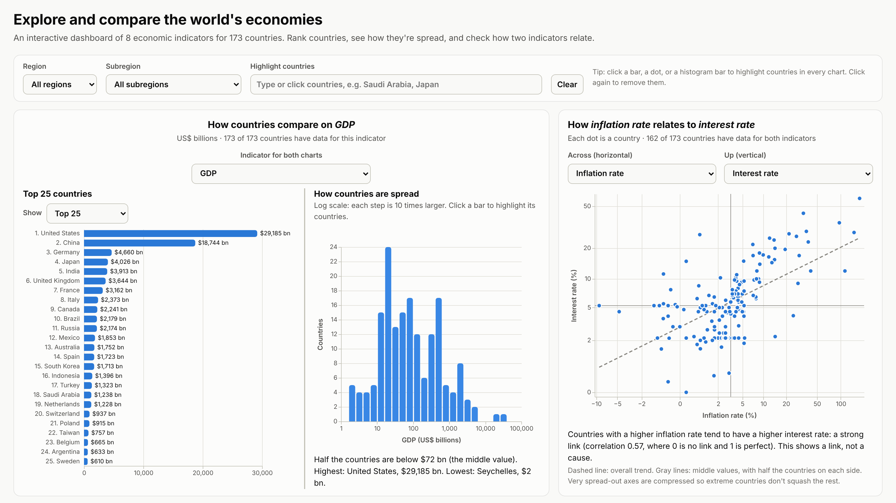
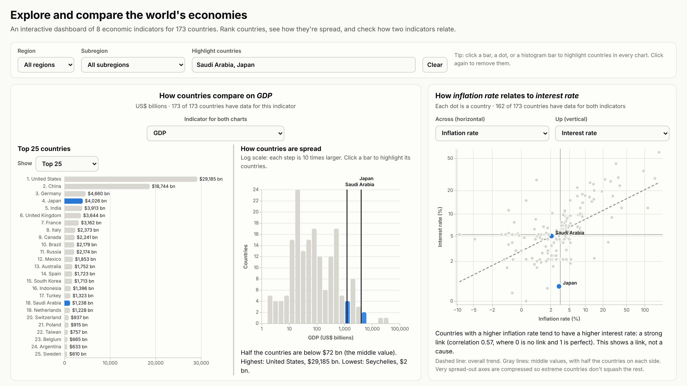

# Interactive Economic Dashboard — Data Visualization

**An interactive dashboard designed to help the general public explore and compare the world's economies in a clear, accessible, and user-friendly way.**

It covers 8 economic indicators for 173 countries: rank countries, see how they're spread, and check how two indicators relate.

**[View live dashboard](https://ayoubaldawood.github.io/interactive-economic-dashboard/)**



<p align="center"><em>Default view: all three charts on one screen</em></p>

## What You Can Do

- **Rank countries** on any indicator: top 10, 25, 50, or all 173.
- **See the spread** of the same indicator in a histogram, with the middle value, the highest, and the lowest spelled out.
- **Compare two indicators** in a scatter plot with a trend line, the middle values, and a one-sentence summary of how strongly they're linked.
- **Filter** by region and subregion.
- **Highlight countries** by typing their names, clicking a bar or a dot, or clicking a histogram bar to pick every country in that range. Highlighted countries stand out in all three charts at once.
- **Read the numbers** in a table you can sort.



<p align="center"><em>Highlighting countries: Saudi Arabia and Japan stand out in all three charts at once</em></p>

## Design Decisions

- **Built for the general public.** Chart titles update with your choices and show the indicator names in italics, each chart names its unit, bars show their values, and statistics come in plain words (the correlation is explained on a scale from 0 to 1).
- **Everything on one screen.** On a desktop, the three charts sit side by side and size themselves to the window, so a highlight shows up in every chart without scrolling. On phones, the charts stack.
- **One question per chart.** Ranking (bar chart), spread (histogram), and relationship (scatter plot), following Shneiderman's "overview first, zoom and filter, then details on demand." The ranking and the histogram share one card and one indicator picker, so it's clear the picker changes both.
- **Color that means something.** Every country shares one color; highlighted countries keep it and the rest turn gray, which also works in grayscale and on paper. Five region colors were tested with a color-blindness checker and couldn't be told apart reliably in a scatter plot, so region became a filter instead.
- **A readable first view.** GDP ranges from $2 billion to over $29 trillion, so GDP and GDP per person use a log scale. Inflation and interest rates use a compressed scale, so a few extreme values (like Venezuela's 172% inflation) don't squash everyone else. Trend lines are fitted on the scale you see, and gray lines mark the middle values, which suit skewed data better than averages.
- **Missing data stays visible.** Each chart says how many countries have data; interest rates, for example, are missing for 11 countries.
- **Accessible.** Colors are checked for contrast, every bar and dot has a screen-reader description, every value is also in the table, and the page follows your system's dark mode.

## Key Findings

- **Two economies dominate.** The US and China produce 44% of the combined GDP of all 173 countries, and the top 10 produce 67%. Half the countries have an economy smaller than $72 billion.
- **Living standards vary enormously.** GDP per person ranges from about $140 in Burundi to over $100,000 in Luxembourg, Ireland, and Switzerland. Half the countries are below $7,540.
- **Inflation and interest rates move together.** Countries with higher inflation tend to have higher interest rates (Spearman ρ = 0.57 across 162 countries), which fits central banks raising rates to fight inflation. The data alone can't show cause and effect.
- **Government debt is lowest in Asia.** The median Asian country's debt is 39% of GDP, compared with 55% to 60% in Africa, the Americas, and Europe.

## Data

The data is based on the [World Economic Dataset (2025) on Kaggle](https://www.kaggle.com/datasets/ahmadfirman/world-economic-2025/data): 173 countries in 5 regions and 22 subregions.

- GDP is in US$ billions. The other indicators are percentages, with budget balance, government debt, and current account as shares of GDP.
- **GDP per person** is calculated in `dashboard.py` from GDP and population, in US$. The source rounds populations to tens of thousands, so the figures for Monaco, Liechtenstein, and the Cayman Islands are approximate.
- **GDP growth is left out.** Most countries report growth over the previous quarter (China shows 1.1%), while some report an annualized rate (the US shows 3.0%), and 72 countries have no value. Compared side by side, the figures would mislead.
- Countries without a value for an indicator are left out of that chart; nothing is filled in.

## How It's Built

- `dashboard.py` loads the data with pandas, calculates GDP per person, and builds every chart with Altair, which produces Vega-Lite specifications.
- `page_template.html` holds the page layout and a short JavaScript script that connects the controls to the charts, sizes the charts to the screen, and writes the summaries and the table.
- Running `dashboard.py` writes `index.html`: a single page with the data built in, which GitHub Pages serves as the live dashboard.

To build it yourself:

```
pip install -r requirements.txt
python dashboard.py
```

Then open `index.html` in a browser.

## Files

| File | What it is |
|---|---|
| `index.html` | The live dashboard |
| `dashboard.py` | Builds `index.html` |
| `page_template.html` | Page layout and interaction script |
| `country_economics_data.csv` | The data |
| `requirements.txt` | Python packages |
| `images/` | Screenshots |

## Skills Demonstrated

Data visualization · Interaction design · Responsive design · UX writing · Accessibility · Data analysis · Python (pandas) · Altair (Vega-Lite)
